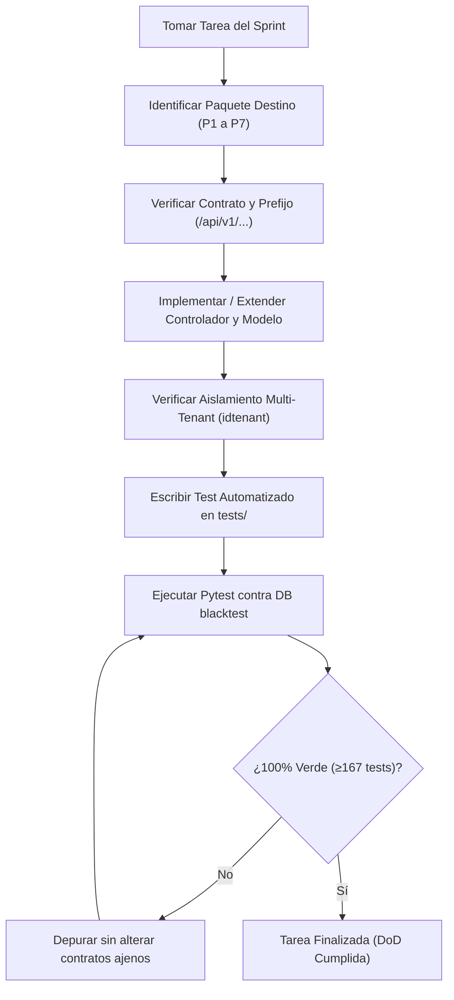

# Fases de Implementación y Roadmap de Sprints

> **Documento:** Guía de Ejecución y Hoja de Ruta (Diátaxis Framework)  
> **Metodología:** SCRUM con seguimiento en Jira · **Equipo:** Grupo 5  
> **Alcance:** 5 Sprints (Sprint 0 al Sprint 4), 37 Casos de Uso (CU), 65 Tareas, 285 Horas  
> **Audiencia:** Scrum Master, Desarrolladores Fullstack y Agentes Autónomos de Codificación  

---

## 1. Marco Metodológico y Criterios de Calidad

El desarrollo del sistema de trazabilidad blockchain se ejecuta de forma iterativa e incremental en 5 Sprints bajo el marco de trabajo SCRUM. Para garantizar que cada entrega preserve la integridad arquitectónica y la suite de pruebas automatizadas, se establecen los siguientes criterios obligatorios:

### Definition of Ready (DoR) — Antes de iniciar una Tarea / CU
1. **Límites de Dominio Claros:** El Caso de Uso debe estar asignado formalmente a uno de los 7 paquetes (P1 a P7).
2. **Contratos Definidos:** Los esquemas Pydantic (Request/Response) y las rutas HTTP (`/api/v1/...`) deben estar especificados antes de escribir lógica.
3. **Roles y Permisos Mapeados:** Se debe conocer qué roles tienen permiso de lectura y cuáles de escritura (`require_roles`).
4. **Dependencias Resueltas:** Si el CU interactúa con otro paquete (ej. Recepción hacia Unidades), la interfaz o *seam* del paquete proveedor debe estar disponible.

### Definition of Done (DoD) — Para dar por concluida una Tarea / CU
1. **Código Implementado:** Controlador FastAPI, modelo SQLAlchemy 2.0 y esquemas Pydantic funcionales.
2. **Aislamiento Multi-Tenant:** Toda consulta de lectura/escritura filtra estrictamente por `tenant_id` (salvo bypass explícito de SuperAdmin).
3. **Auditoría Automática:** Endpoints sensibles integrados con el middleware de bitácora (`CU-005`).
4. **Pruebas Automatizadas Verdes:** Tests unitarios y de integración agregados en `trazabilidad/backend/tests/` ejecutados exitosamente con `pytest` contra la base de datos de prueba (`blacktest`).
5. **Cero Regresiones:** Los tests previos (actualmente **167 tests pasando al 100%**) deben mantenerse en verde (`100% passed`).

---

## 2. Matriz de Trazabilidad: Sprints vs. Paquetes

| Sprint | Objetivo Central | Paquetes Involucrados | Casos de Uso (CU) | Cant. CUs | Estado Actual |
| :---: | :--- | :--- | :--- | :---: | :---: |
| **S0** | Arquitectura, Multi-Tenant, Usuarios y Roles | **P1** | CU-001, CU-002, CU-003 | 3 | **Completado / Auditado** |
| **S1** | Autenticación, Catálogo y Actores | **P1, P2, P3** | CU-004, CU-006, CU-007, CU-008, CU-009, CU-013, CU-014 | 7 | **Completado / Auditado** |
| **S2** | Compras, Unidades Físicas y Logística | **P2, P4** | CU-010, CU-011, CU-012, CU-015, CU-016, CU-019, CU-020, CU-021 | 8 | **Completado (120/120 Tests)** |
| **S3** | Trazabilidad Digital, Blockchain, SaaS y Autenticidad | **P1, P4, P5, P6** | CU-017, CU-018, CU-022, CU-023, CU-024, CU-032, CU-033, CU-034, CU-036, CU-037 | 10 | **Avanzado (167 Tests Verdes)** |
| **S4** | Comercialización, Devoluciones, Reportes | **P1, P5, P7** | CU-005, CU-025, CU-026, CU-027, CU-028, CU-029, CU-030, CU-031, CU-035 | 9 | **Planificado** |

---

## 3. Desglose Detallado de Tareas por Sprint

### Sprint 0: Arquitectura, Empresas, Usuarios y Roles (57 horas)
*Estado: Completado y auditado.*

| ID | Rol | Tarea / Funcionalidad | Plataforma | Horas | Paquete |
| :--- | :--- | :--- | :--- | :---: | :---: |
| **T001** | Dev Team (Arq) | Definición de la arquitectura general del sistema | Arquitectura | 5 | Base |
| **T002** | Dev Team (Backend) | Configuración inicial del proyecto Backend con FastAPI | Backend | 4 | Base |
| **T003** | Dev Team (Frontend) | Configuración inicial de la plataforma Web con Angular | Web | 4 | Base |
| **T004** | Dev Team (Mobile) | Configuración inicial de la aplicación Móvil con Flutter | Móvil | 4 | Base |
| **T005** | Dev Team (Backend) | Configuración de la conexión con PostgreSQL y Alembic | Backend | 4 | Base |
| **T006** | Dev Team (Backend) | Diseño del modelo de datos para empresas, usuarios, roles y productos | DB | 5 | P1 |
| **T007** | Dev Team (Backend) | Definición de entidades y relaciones principales del sistema | DB | 4 | P1 |
| **T008** | Dev Team (Backend) | Gestión de empresas y configuración multi-tenant (API REST) | Backend | 5 | P1 |
| **T009** | Dev Team (Frontend) | Interfaz de gestión de empresas (UI Angular) | Web | 4 | P1 |
| **T010** | Dev Team (Backend) | Gestión de usuarios del sistema (API REST) | Backend | 5 | P1 |
| **T011** | Dev Team (Frontend) | Interfaz de administración de usuarios (UI Angular) | Web | 4 | P1 |
| **T012** | Dev Team (Backend) | Roles y permisos de usuarios (RBAC) | Backend | 5 | P1 |
| **T013** | Dev Team (Frontend) | Interfaz de asignación de roles y permisos (UI Angular) | Web | 4 | P1 |

---

### Sprint 1: Autenticación, Catálogo y Ubicaciones (54 horas)
*Estado: Completado y auditado.*

| ID | Rol | Tarea / Funcionalidad | Plataforma | Horas | Paquete |
| :--- | :--- | :--- | :--- | :---: | :---: |
| **T014** | Dev Team (Backend) | Implementación de autenticación JWT y refresh token | Backend | 5 | P1 |
| **T015** | Dev Team (Frontend) | Pantallas de login, logout y guards por rol en Angular | Web | 4 | P1 |
| **T016** | Dev Team (Mobile) | Módulo de autenticación en Flutter | Móvil | 4 | P1 |
| **T017** | Dev Team (Backend) | Gestión de productos Apple y variantes (color, capacidad) | Backend | 5 | P2 |
| **T018** | Dev Team (Frontend) | Catálogo administrativo de productos y variantes | Web | 4 | P2 |
| **T019** | Dev Team (Backend) | Gestión de certificaciones técnicas de dispositivos | Backend | 4 | P2 |
| **T020** | Dev Team (Backend) | Catálogo específico y precios por empresa (CatalogoTenant) | Backend | 4 | P2 |
| **T021** | Dev Team (Frontend) | Vista de asignación de productos al catálogo de empresa | Web | 4 | P2 |
| **T022** | Dev Team (Backend) | Clasificación de dispositivos en categorías taxonómicas | Backend | 4 | P2 |
| **T023** | Dev Team (Backend) | Registro maestro de actores de la cadena de suministro | Backend | 4 | P3 |
| **T024** | Dev Team (Frontend) | Interfaz para gestión de proveedores y transportistas | Web | 4 | P3 |
| **T025** | Dev Team (Backend) | Registro de ubicaciones físicas y coordenadas GPS | Backend | 4 | P3 |
| **T026** | Dev Team (Frontend) | Interfaz de ubicaciones georreferenciadas | Web | 4 | P3 |

---

### Sprint 2: Compras, Inventario y Logística (53 horas)
*Estado: Completado y verificado (120 tests).*

| ID | Rol | Tarea / Funcionalidad | Plataforma | Horas | Paquete |
| :--- | :--- | :--- | :--- | :---: | :---: |
| **T027** | Dev Team (Backend) | Órdenes de compra y detalle de importación (API REST) | Backend | 5 | P2 |
| **T028** | Dev Team (Frontend) | Formulario de registro y detalle de orden de compra | Web | 4 | P2 |
| **T029** | Dev Team (Backend) | Flujo de aprobación y cancelación de órdenes de compra | Backend | 4 | P2 |
| **T030** | Dev Team (Backend) | Recepción física de mercancía y actas de ingreso | Backend | 5 | P2 |
| **T031** | Dev Team (Frontend) | Pantalla de control de recepción de compras | Web | 4 | P2 |
| **T032** | Dev Team (Backend) | Individualización de unidades físicas (Serial/IMEI/EID) | Backend | 5 | P4 |
| **T033** | Dev Team (Frontend) | Carga y gestión de inventario de unidades serializadas | Web | 4 | P4 |
| **T034** | Dev Team (Backend) | Generación criptográfica de códigos QR para unidades | Backend | 4 | P4 |
| **T035** | Dev Team (Frontend) | Visualización y descarga en lote de etiquetas QR | Web | 4 | P4 |
| **T036** | Dev Team (Backend) | Envíos logísticos y manifiesto de transporte | Backend | 5 | P4 |
| **T037** | Dev Team (Frontend) | Monitoreo y despacho de envíos logísticos | Web | 5 | P4 |

---

### Sprint 3: Trazabilidad Digital, Blockchain, SaaS y Autenticidad (64 horas)
*Estado: En ejecución avanzada (167 tests verdes).*

| ID | Rol | Tarea / Funcionalidad | Plataforma | Horas | Paquete | Estado |
| :--- | :--- | :--- | :--- | :---: | :---: | :---: |
| **T038** | Dev Team (Backend) | Endpoints de eventos de trazabilidad y sensores ambientales | Backend | 5 | P4 | **Completado** |
| **T039** | Dev Team (Blockchain) | Conexión con testnet Ethereum (Sepolia/Amoy) vía Web3.py | Blockchain | 4 | P6 | **En Conexión** |
| **T040** | Dev Team (Blockchain) | Smart Contract Solidity para notarización inmutable | Blockchain | 5 | P6 | **Estructurado** |
| **T041** | Dev Team (Blockchain) | Lógica de cálculo y almacenamiento de hashes on-chain | Blockchain | 4 | P6 | **Estructurado** |
| **T042** | Dev Team (Backend) | Integración de servicio Web3.py con controladores FastAPI | Backend | 5 | P6 | **En Conexión** |
| **T043** | Dev Team (Backend) | Enriquecimiento de eventos con actor, ubicación y fecha | Backend | 4 | P4 | **Completado** |
| **T044** | Dev Team (Backend) | Persistencia de txHash y blockNumber en PostgreSQL | Backend | 4 | P4 / P6 | **Completado** |
| **T045** | Dev Team (Blockchain) | Endpoint de verificación de integridad criptográfica (CU-033) | Blockchain | 5 | P6 | **En Conexión** |
| **T046** | Dev Team (Mobile) | Escaneo de códigos QR mediante cámara nativa (Flutter) | Móvil | 4 | P4 | **En Desarrollo** |
| **T047** | Dev Team (Mobile) | Consulta del historial de trazabilidad mediante QR (Flutter) | Móvil | 5 | P4 | **En Desarrollo** |
| **T048** | Dev Team (Backend/Web) | Reporte de sospecha de falsificación y Machine Learning (CU-023) | Fullstack | 5 | P4 | **Completado** |
| **T049** | Dev Team (Backend) | Carga de documentos con hashing SHA-256 (CU-032) | Backend | 4 | P5 | **Completado (265 docs)** |
| **T050S** | Dev Team (Fullstack) | Gestión de Planes de Suscripción SaaS (CU-036) | Fullstack | 5 | P1 | **Completado** |
| **T052S** | Dev Team (Fullstack) | Suscripción de Empresas a Planes SaaS (CU-037) | Fullstack | 5 | P1 | **Completado** |

---

### Sprint 4: Ventas, Consumidor, Devoluciones y Reportes (57 horas)
*Estado: Planificado.*

| ID | Rol | Tarea / Funcionalidad | Plataforma | Horas | Paquete |
| :--- | :--- | :--- | :--- | :---: | :---: |
| **T050** | Dev Team (Backend) | Gestión de ventas y asignación de unidades (Serial/IMEI) | Backend | 5 | P5 |
| **T051** | Dev Team (Frontend) | Interfaz de gestión de ventas y unidades asociadas | Web | 5 | P5 |
| **T052** | Dev Team (Backend) | Pagos y registro de transacciones referenciales | Backend | 5 | P5 |
| **T053** | Dev Team (Backend) | Devoluciones y asignación de unidades devueltas | Backend | 5 | P5 |
| **T054** | Dev Team (Frontend) | Interfaz de devoluciones y garantías por unidad | Web | 4 | P5 |
| **T055** | Dev Team (Backend) | Gestión de pólizas de garantía por unidad (API REST) | Backend | 4 | P5 |
| **T056** | Dev Team (Backend) | Historial de compras, favoritos y preferencias | Backend | 4 | P5 |
| **T057** | Dev Team (Frontend) | Interfaz de historial de compras y preferencias | Web | 4 | P5 |
| **T058** | Dev Team (Backend) | Notificaciones push y alertas de incidencias | Backend | 5 | P4 |
| **T059** | Dev Team (Frontend) | Interfaz web de notificaciones y alertas | Web | 4 | P4 |
| **T060** | Dev Team (Backend) | Generación de certificados digitales PDF con hash blockchain | Backend | 5 | P6 / P7 |
| **T061** | Dev Team (Frontend) | Dashboard administrativo y visualización de reportes (KPIs) | Web | 5 | P7 |

---

## 4. Guía Operativa para Agentes de Codificación

