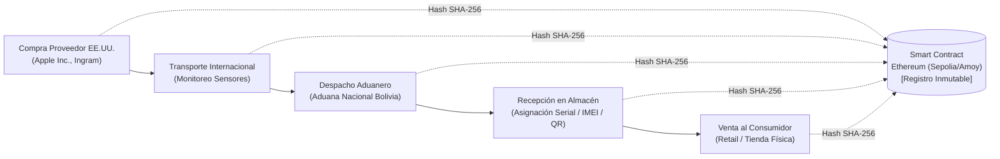
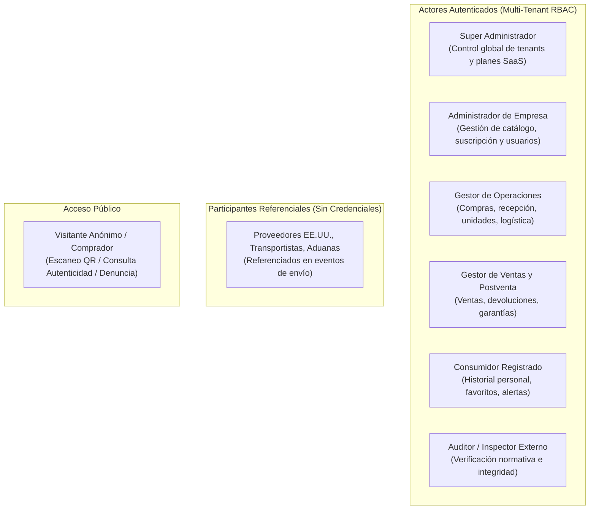

# Contexto del Proyecto: Trazabilidad Blockchain para Dispositivos Apple

> **Documento:** Explicación y Contexto de Negocio (Diátaxis Framework)  
> **Ubicación:** `docs/PROJECT_CONTEXT.md`  
> **Metodología:** SCRUM · **Sprint Activo:** **Sprint 3 (Trazabilidad, Blockchain, SaaS Multi-Tenant y Autenticidad)**  
> **Estado del Código:** Sprints 0, 1, 2 y CU-023/CU-024/CU-032/CU-036/CU-037 **100% Implementados (167 tests verdes en `blacktest`)**  
> **Audiencia:** Equipo de Desarrollo, Product Owner, Scrum Master y Agentes Autónomos  

---

## 1. El Problema de Negocio y Dominio

En Bolivia, el mercado de dispositivos Apple de alta gama (iPhone, MacBook, iPad y accesorios) depende en un 100% de canales de importación desde Estados Unidos. Sin embargo, este mercado enfrenta tres desafíos críticos:

1. **Asimetría de Información y Desconfianza:** El comprador final no puede comprobar si un dispositivo vendido a precio premium es genuino, legalmente importado o una réplica/dispositivo reacondicionado vendido como nuevo (*Problema de los Limones de Akerlof*).
2. **Falta de Trazabilidad en la Cadena Logística:** Los importadores locales carecen de registros confiables e integrados sobre el trayecto internacional, el paso por aduanas y las condiciones físicas del transporte (temperatura, humedad y vibraciones que afectan las baterías de litio y componentes ópticos).
3. **Vulnerabilidad de Registros Centralizados:** Las bases de datos convencionales o etiquetas adhesivas pueden ser manipuladas o adulteradas sin dejar evidencia criptográfica.

---

## 2. La Solución Tecnológica

El proyecto implementa una **Plataforma Web (Angular 17+) y Aplicación Móvil (Flutter) con Backend REST (FastAPI) y Persistencia Inmutable en Blockchain (Ethereum Sepolia/Amoy)** que transforma cada dispositivo físico en un portador de su propia historia digital verificable:

### Pilares Fundamentales de la Solución
* **Identificadores Físicos Únicos:** Cada unidad se vincula individualmente a su Número de Serie de Apple, IMEI (para modelos con conectividad celular), EID (para eSIM) y recibe un código QR / tag NFC único.
* **Modelo Híbrido On-Chain / Off-Chain:**
  * *Off-Chain (PostgreSQL + Cloud Storage):* Almacena datos operacionales masivos, metadatos, facturas comerciales, pólizas aduaneras DUI y fotografías de respaldo.
  * *On-Chain (Ethereum Smart Contracts):* Registra de forma inmutable la tupla criptográfica (`unitId`, `eventHash`, `timestamp`, `operatorAddress`).
* **Arquitectura Multi-Tenant y Modelo SaaS:** Múltiples empresas importadoras y distribuidoras operan de forma estrictamente aislada (`tenant_id`), administrando planes de suscripción (`trial`, `basico`, `pro`, `enterprise`) y cuotas de uso (usuarios, dispositivos serializados, almacenamiento).
* **Consulta Pública Universal y Detección de Fraude:** Cualquier persona puede escanear el código QR del equipo y verificar su historial y autenticidad en la API pública (`/api/v1/trace/{uuid}`) sin autenticación obligatoria, o reportar sospechas de falsificación con evaluación de riesgo mediante Machine Learning (`CU-023`).

---

## 3. Delimitación del Alcance (Scope)

* **Lo que el sistema SÍ hace:**
  * Control del ciclo completo de importación (órdenes de compra, aprobación, recepción de inventario y unidades serializadas).
  * Monitoreo de envíos logísticos y registro de condiciones ambientales en ruta.
  * Gestión de planes SaaS de suscripción para empresas clientes (`CU-036`, `CU-037`).
  * Notarización criptográfica en contratos inteligentes de Solidity.
  * Gestión documental con hashing SHA-256 (facturas, pólizas aduaneras DUI, actas técnicas) (`CU-032`).
  * Generación y descarga de certificados digitales de autenticidad en PDF con verificación de hash.
  * Detección de sospechas de falsificación mediante análisis de texto con Machine Learning.
  * Consulta pública y móvil del historial de trazabilidad.
* **Lo que el sistema NO hace:**
  * **No** es una pasarela de pagos pasiva: el registro de cobros (`CU-027` / Sprint 4) es de carácter referencial y contable.
  * **No** incluye carrito de compras tradicional de retail masivo; las ventas se gestionan como eventos de salida logística hacia el comprador final.

---

## 4. Taxonomía de Actores del Ecosistema

---

## 5. Marco Metodológico y Estado del Proyecto (SCRUM)

El proyecto se gestiona rigurosamente bajo el marco de trabajo **SCRUM** en 5 Sprints (Sprint 0 al 4).

### Estado Actual: SPRINT 3 AVANZADO / EN EJECUCIÓN

* **Sprints Completados y Auditados:**
  * **Sprint 0:** Cimientos de Arquitectura, Configuración de Entorno, Multi-Tenant, Usuarios y Roles (`CU-001`, `CU-002`, `CU-003`).
  * **Sprint 1:** Autenticación JWT, Catálogo de Productos y Variantes Apple, Certificaciones Técnicas, Categorías, Actores de la Cadena y Ubicaciones Físicas (`CU-004`, `CU-006` al `CU-009`, `CU-013`, `CU-014`).
  * **Sprint 2:** Compras, Aprobaciones, Recepción de Mercancía, Gestión de Unidades (Serial/IMEI/EID), Generación de Códigos QR, Envíos Logísticos y Condiciones de Transporte (`CU-010` al `CU-012`, `CU-015`, `CU-016`, `CU-019` al `CU-021`).
* **Sprint 3 (En Ejecución y Logros Clave):**
  * ✅ **CU-023 (Web + ML):** Reporte de sospecha de falsificación con subida de evidencias, geolocalización y evaluación de riesgo mediante Machine Learning (`SuspicionMLService`).
  * ✅ **CU-024:** Alertas e incidencias multi-tenant con datos realistas poblados (31 alertas globales).
  * ✅ **CU-032:** Gestión y carga de documentos por unidad con hashing SHA-256 (265 documentos oficiales en PostgreSQL: facturas USA, pólizas DUI, garantías AppleCare y actas técnicas).
  * ✅ **CU-036 & CU-037:** Módulo SaaS Multi-tenant (Planes de suscripción con límites y suscripción de empresas con hook automático en registro de tenants y vistas completas en Angular).
  * 🔄 **En Conexión / Próximo:** Integración Web3.py a testnet Sepolia/Amoy (`CU-033`), verificación criptográfica on-chain (`CU-034`) y escaneo móvil Flutter (`CU-017`).
* **Sprint Próximo (Planificado):**
  * **Sprint 4 (Comercialización, Devoluciones, Garantías y Reportes):** Ventas, asignación de unidades vendidas, devoluciones, garantías y dashboards analíticos (`CU-025` al `CU-031`, `CU-035`).

* **Suite de Pruebas Automatizadas:** **167 tests pasando al 100% (0 fallos, 0 errores)** en PostgreSQL (`blacktest`).
