# Mapa Integral de Casos de Uso (Use Cases Map)

> **Documento:** Referencia Canónica de Casos de Uso (Diátaxis Framework)  
> **Ubicación:** `docs/USE_CASES_MAP.md`  
> **Fuente Canónica:** Documento Oficial de Especificación `sprint#3_actualizado.pdf` (Secciones 3.9 y 3.10)  
> **Metodología:** SCRUM · **Sprint Activo:** **Sprint 3 (Trazabilidad, Blockchain, SaaS y Autenticidad)**  
> **Estado de Implementación:** Sprints 0, 1, 2 y CU-023/CU-024/CU-032/CU-036/CU-037 **Implementados y Verificados (167 tests verdes en `blacktest`)**  

---

## 1. Tabla Maestra Consolidada (40 Casos de Uso Oficiales)

Alineada con la tabla de la Sección 3.9 (páginas 92-94) del documento `sprint#3_actualizado.pdf`:

| ID | Caso de Uso | Sprint | Web | Móvil | Prioridad | Paquete | Estado |
| :--- | :--- | :---: | :---: | :---: | :---: | :---: | :---: |
| **CU-001** | Gestionar Empresas (Tenants) | 0 | ✓ | — | Alta | P1 | **Implementado** |
| **CU-002** | Gestionar Usuarios del Sistema | 0 | ✓ | — | Alta | P1 | **Implementado** |
| **CU-003** | Asignar Roles y Permisos a Usuario | 0 | ✓ | — | Alta | P1 | **Implementado** |
| **CU-004** | Autenticar y Recuperar Contraseña | 1 | ✓ | ✓ | Alta | P1 | **Implementado** |
| **CU-005** | Consultar Bitácora y Gestionar Notificaciones | 3 | ✓ | ✓ | Media | P1 | **Implementado** |
| **CU-006** | Gestionar Productos y Variantes | 1 | ✓ | — | Alta | P2 | **Implementado** |
| **CU-007** | Gestionar Certificaciones Técnicas | 1 | ✓ | — | Media | P2 | **Implementado** |
| **CU-008** | Gestionar Catálogo por Empresa | 1 | ✓ | — | Alta | P2 | **Implementado** |
| **CU-009** | Gestionar Categorías de Productos | 1 | ✓ | — | Media | P2 | **Implementado** |
| **CU-010** | Gestionar Órdenes de Compra | 2 | ✓ | ✓ | Alta | P2 | **Implementado** |
| **CU-011** | Aprobar / Rechazar Compra | 2 | ✓ | ✓ | Alta | P2 | **Implementado** |
| **CU-012** | Gestionar Recepciones de Mercancía | 2 | ✓ | — | Alta | P2 | **Implementado** |
| **CU-013** | Gestionar Actores de la Cadena | 1 | ✓ | — | Media | P3 | **Implementado** |
| **CU-014** | Gestionar Ubicaciones Físicas | 1 | ✓ | — | Media | P3 | **Implementado** |
| **CU-015** | Gestionar Unidades de Producto (Serial/IMEI) | 1 | ✓ | — | Alta | P4 | **Implementado** |
| **CU-016** | Generar y Descargar Código QR | 2 | ✓ | ✓ | Alta | P4 | **Implementado** |
| **CU-017** | Escanear Código QR | 3 | — | ✓ | Alta | P4 | **En Desarrollo** |
| **CU-018** | Registrar Consulta de Trazabilidad | 3 | ✓ (Backend) | ✓ (Backend) | Alta | P4 | **Implementado** |
| **CU-019** | Gestionar Envíos Logísticos | 2 | ✓ | — | Alta | P4 | **Implementado** |
| **CU-020** | Asignar / Desasignar Unidades a Envío | 2 | ✓ | — | Alta | P4 | **Implementado** |
| **CU-021** | Registrar Eventos y Condiciones de Transporte | 2 | ✓ | ✓ | Alta | P4 | **Implementado** |
| **CU-022** | Consultar Historial y Verificar Autenticidad | 3 | ✓ | ✓ | Alta | P4 | **En Desarrollo** |
| **CU-023** | Reportar Sospecha de Falsificación | 3 | — | ✓ | Media | P4 | **Implementado (Web + Móvil)** |
| **CU-024** | Gestionar Alertas e Incidencias | 4 | ✓ | ✓ | Alta | P4 | **Implementado (Poblado)** |
| **CU-025** | Gestionar Ventas | 4 | ✓ | — | Alta | P5 | **Planificado** |
| **CU-026** | Asignar Unidades Físicas a Venta | 4 | ✓ | — | Alta | P5 | **Planificado** |
| **CU-027** | Gestionar Pagos | 4 | ✓ | — | Media | P5 | **Planificado** |
| **CU-028** | Consultar Historial de Compras del Consumidor | 4 | ✓ | ✓ | Media | P5 | **Planificado** |
| **CU-029** | Gestionar Devoluciones | 4 | ✓ | — | Alta | P5 | **Planificado** |
| **CU-030** | Asignar Unidades a Devolución | 4 | ✓ | — | Alta | P5 | **Planificado** |
| **CU-031** | Gestionar Garantías por Unidad | 4 | ✓ | — | Alta | P5 | **Planificado** |
| **CU-032** | Adjuntar Documentos a Unidades | 2 | ✓ | — | Media | P5 | **Implementado (265 docs)** |
| **CU-033** | Registrar Evento en Blockchain | 3 | ✓ (Backend) | — | Alta | P6 | **En Desarrollo** |
| **CU-034** | Consultar Registros Blockchain y Certificados | 3 | ✓ | ✓ (lectura) | Alta | P6 | **En Desarrollo** |
| **CU-035** | Gestionar Reportes y Dashboards | 4 | ✓ | — | Alta | P7 | **Planificado** |
| **CU-036** | Gestionar Planes de Suscripción | 3 | ✓ | — | Alta | P8 | **Implementado** |
| **CU-037** | Gestionar Suscripción y Pagos | 3 | ✓ | — | Alta | P8 | **Implementado** |
| **CU-038** | Controlar Cuotas y Consumo | 3 | ✓ (Backend) | — | Alta | P8 | **Planificado (Sprint 4)** |
| **CU-039** | Gestionar Facturación e Historial | 3 | ✓ | — | Media | P8 | **Planificado (Sprint 4)** |
| **CU-040** | Notificar Eventos de Facturación | 3 | ✓ | ✓ | Media | P8 | **Planificado (Sprint 4)** |

---

## 2. Organización por Paquetes de Dominio (8 Paquetes Oficiales)

Conforme a la sección **3.10. Paquetes y Casos de Uso** (páginas 94-97) de `sprint#3_actualizado.pdf`, el sistema se organiza formalmente en **8 paquetes**:

```mermaid
flowchart TD
    P1["3.10.1. P1 - Seguridad y Multi-Tenant\n(CU-001, CU-002, CU-003, CU-004, CU-005)"]
    P2["3.10.2. P2 - Catálogo y Abastecimiento\n(CU-006, CU-007, CU-008, CU-009, CU-010, CU-011, CU-012)"]
    P3["3.10.3. P3 - Actores y Ubicaciones\n(CU-013, CU-014)"]
    P4["3.10.4. P4 - Inventario y Trazabilidad (Núcleo)\n(CU-015, CU-016, CU-017, CU-018, CU-019, CU-020, CU-021, CU-022, CU-023, CU-024)"]
    P5["3.10.5. P5 - Comercialización (Ventas y Postventa)\n(CU-025, CU-026, CU-027, CU-028, CU-029, CU-030, CU-031, CU-032)"]
    P6["3.10.6. P6 - Blockchain y Certificados\n(CU-033, CU-034)"]
    P7["3.10.7. P7 - Reportes y Administración\n(CU-035)"]
    P8["3.10.8. P8 - Suscripción y Monetización SaaS\n(CU-036, CU-037, CU-038, CU-039, CU-040)"]
```

### Detalle de Paquetes:

1. **P1 - Seguridad y Multi-Tenant (5 CUs):**
   * `CU-001`: Gestionar Empresas (Tenants)
   * `CU-002`: Gestionar Usuarios del Sistema
   * `CU-003`: Asignar Roles y Permisos a Usuario
   * `CU-004`: Autenticar y Recuperar Contraseña
   * `CU-005`: Consultar Bitácora y Gestionar Notificaciones
2. **P2 - Catálogo y Abastecimiento (7 CUs):**
   * `CU-006`: Gestionar Productos y Variantes
   * `CU-007`: Gestionar Certificaciones Técnicas
   * `CU-008`: Gestionar Catálogo por Empresa
   * `CU-009`: Gestionar Categorías de Productos
   * `CU-010`: Gestionar Órdenes de Compra
   * `CU-011`: Aprobar / Rechazar Compra
   * `CU-012`: Gestionar Recepciones de Mercancía
3. **P3 - Actores y Ubicaciones (2 CUs):**
   * `CU-013`: Gestionar Actores de la Cadena
   * `CU-014`: Gestionar Ubicaciones Físicas
4. **P4 - Inventario y Trazabilidad - Núcleo (10 CUs):**
   * `CU-015`: Gestionar Unidades de Producto (Serial/IMEI)
   * `CU-016`: Generar y Descargar Código QR
   * `CU-017`: Escanear Código QR
   * `CU-018`: Registrar Consulta de Trazabilidad
   * `CU-019`: Gestionar Envíos Logísticos
   * `CU-020`: Asignar / Desasignar Unidades a Envío
   * `CU-021`: Registrar Eventos y Condiciones de Transporte
   * `CU-022`: Consultar Historial y Verificar Autenticidad
   * `CU-023`: Reportar Sospecha de Falsificación
   * `CU-024`: Gestionar Alertas e Incidencias
5. **P5 - Comercialización - Ventas y Postventa (8 CUs):**
   * `CU-025`: Gestionar Ventas
   * `CU-026`: Asignar Unidades Físicas a Venta
   * `CU-027`: Gestionar Pagos
   * `CU-028`: Consultar Historial de Compras del Consumidor
   * `CU-029`: Gestionar Devoluciones
   * `CU-030`: Asignar Unidades a Devolución
   * `CU-031`: Gestionar Garantías por Unidad
   * `CU-032`: Adjuntar Documentos a Unidades
6. **P6 - Blockchain y Certificados (2 CUs):**
   * `CU-033`: Registrar Evento en Blockchain
   * `CU-034`: Consultar Registros Blockchain y Certificados
7. **P7 - Reportes y Administración (1 CU):**
   * `CU-035`: Gestionar Reportes y Dashboards
8. **P8 - Suscripción y Monetización SaaS (5 CUs):**
   > *Este paquete agrupa los casos de uso CU-036 a CU-040 orientados a la gestión de planes SaaS, procesamiento de pagos recurrentes, facturación y control de límites por empresa.*
   * `CU-036`: Gestionar Planes de Suscripción (**Implementado**)
   * `CU-037`: Gestionar Suscripción y Pagos (**Implementado**)
   * `CU-038`: Controlar Cuotas y Consumo
   * `CU-039`: Gestionar Facturación e Historial
   * `CU-040`: Notificar Eventos de Facturación

---

## 3. Matriz por Plataforma de Ejecución

### Aplicación Móvil (Flutter)
* `CU-004`: Autenticación móvil y recuperación.
* `CU-005`: Notificaciones push de auditoría y alertas.
* `CU-010`: Consulta y creación rápida de órdenes de compra.
* `CU-011`: Aprobación/rechazo de órdenes en tránsito.
* `CU-016`: Descarga y visualización de QR.
* `CU-017`: **Escaneo nativo de QR / NFC con cámara móvil.** (Foco Sprint 3)
* `CU-021`: Registro en ruta de eventos y condiciones (temperatura/vibración).
* `CU-022`: Visualización interactiva del recorrido y autenticidad del dispositivo.
* `CU-023`: Denuncia y captura fotográfica de sospecha de falsificación.
* `CU-024`: Recepción de alertas logísticas en ruta.
* `CU-028`: Favoritos y consultas del consumidor registrado.
* `CU-034`: Lectura de certificados y validación blockchain.
* `CU-040`: Notificaciones push de eventos de suscripción y facturación.

### Plataforma Web Administrativa (Angular 17+)
* Administración multi-empresa (`CU-001`), usuarios (`CU-002`), roles (`CU-003`).
* Catálogo de productos y certificaciones (`CU-006` al `CU-009`).
* Gestión de compras y recepción (`CU-010` al `CU-012`).
* Gestión de actores y sedes (`CU-013`, `CU-014`).
* Gestión de unidades serializadas y generación masiva de QR (`CU-015`, `CU-016`).
* Monitoreo de envíos logísticos y telemetría (`CU-019`, `CU-020`, `CU-021`).
* Verificación pública de trazabilidad y reporte de falsificación (`CU-018`, `CU-022`, `CU-023`).
* Gestión de alertas e incidencias (`CU-024`).
* Comercialización, devoluciones, garantías y carga documental (`CU-025` al `CU-032`).
* Validación inmutable de bloques y certificados PDF (`CU-033`, `CU-034`).
* Reportes analíticos y KPIs (`CU-035`).
* Gestión de Planes SaaS y suscripciones de empresas (`CU-036`, `CU-037`, `CU-039`).

### Servicios de Backend (FastAPI / Web3 / Workers)
* `CU-005`: Middleware automático de auditoría en PostgreSQL (`Bitacora`).
* `CU-018`: Registro automático de telemetría de escaneos y auditoría.
* `CU-023`: Motor de Machine Learning (`SuspicionMLService`) para scoring de riesgo.
* `CU-033`: Conector Web3.py para firma y minado de transacciones en Ethereum.
* `CU-038`: Middleware evaluador de cuotas y cuellos de botella en tiempo real.
* `CU-040`: Tareas programadas de notificación de expiración y facturación.

---

## 4. Trazabilidad con Requisitos Funcionales Oficiales (RF-01 a RF-36)

Conforme a la Sección 3.7 (páginas 83-90) de `sprint#3_actualizado.pdf`:

| Requisito Funcional | Casos de Uso que lo Implementan | Paquete | Sprint |
| :--- | :--- | :---: | :---: |
| **RF-01** (Autenticación de usuarios) | CU-004 | P1 | S1 |
| **RF-02** (Gestión de roles y permisos) | CU-002, CU-003 | P1 | S0 |
| **RF-03** (Registro y verificación de usuarios) | CU-002, CU-004 | P1 | S0, S1 |
| **RF-04** (Recuperación de contraseña) | CU-004 | P1 | S1 |
| **RF-05** (Bitácora de accesos y actividades) | CU-005 | P1 | S3/S0 |
| **RF-06** (Gestión de empresas / tenants) | CU-001 | P1 | S0 |
| **RF-07** (Registro de productos / catálogo) | CU-006, CU-008 | P2 | S1 |
| **RF-08** (Gestión de categorías y atributos) | CU-009 | P2 | S1 |
| **RF-09** (Registro de certificaciones técnicas) | CU-007 | P2 | S1 |
| **RF-10** (Gestión de órdenes de compra) | CU-010, CU-011 | P2 | S2 |
| **RF-11** (Registro de unidades individuales) | CU-015 | P4 | S1/S2 |
| **RF-12** (Generación de códigos QR/NFC) | CU-016 | P4 | S2 |
| **RF-13** (Registro de movimientos logísticos) | CU-019, CU-020 | P4 | S2 |
| **RF-14** (Registro de eventos de actores externos)| CU-013, CU-021 | P3, P4 | S1, S2 |
| **RF-15** (Registro de condiciones de transporte) | CU-021 | P4 | S2 |
| **RF-16** (Registro de incidencias en cadena) | CU-024 | P4 | S4/S3 |
| **RF-17** (Gestión de devoluciones y garantías) | CU-029, CU-030, CU-031, CU-032 | P5 | S4, S2 |
| **RF-18** (Historial de trazabilidad) | CU-022, CU-032 | P4, P5 | S3 |
| **RF-19** (Registro de eventos en blockchain) | CU-022, CU-033 | P4, P6 | S3 |
| **RF-20** (Consulta de registros blockchain) | CU-034 | P6 | S3 |
| **RF-21** (Verificación de autenticidad) | CU-018, CU-022 | P4 | S3 |
| **RF-22** (Escaneo de código QR/NFC) | CU-017 | P4 | S3 |
| **RF-23** (Acceso público sin registro) | CU-016, CU-018, CU-022 | P4 | S2, S3 |
| **RF-24** (Portal de consulta y exposición externa)| CU-018, CU-022 | P4 | S3 |
| **RF-25** (Favoritos e historial personal) | CU-028 | P5 | S4 |
| **RF-26** (Reporte de sospecha de falsificación) | CU-023 | P4 | S3 |
| **RF-27** (Generación de certificados digitales) | CU-034 | P6 | S3 |
| **RF-28** (Descarga y visualización de certificados)| CU-034 | P6 | S3 |
| **RF-29** (Notificaciones y alertas) | CU-005, CU-024 | P1, P4 | S4/S3 |
| **RF-30** (Reportes y análisis de trazabilidad) | CU-035 | P7 | S4 |
| **RF-31** (Gestión de Planes de Suscripción) | CU-036 | P8 | S3 |
| **RF-32** (Suscripción y Pago Recurrente) | CU-037 | P8 | S3 |
| **RF-33** (Control de Cuotas y Cuellos de Botella) | CU-038 | P8 | S3 |
| **RF-34** (Gestión de Periodos de Prueba / Trials)| CU-036, CU-037 | P8 | S3 |
| **RF-35** (Facturación e Historial de Pagos) | CU-039 | P8 | S3 |
| **RF-36** (Alertas y Notificaciones de Facturación)| CU-040 | P8 | S3 |
