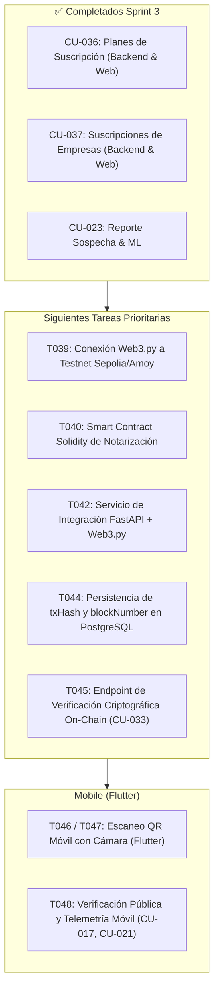

# Próximos Pasos Operativos (Next Steps - Agentes de IA)

> **Documento:** Checklist Táctico y Cola de Trabajo Inmediata para Agentes  
> **Ubicación:** `docs/ai/NEXT_STEPS.md`  
> **Metodología:** SCRUM · **Sprint Activo:** **Sprint 3 (Trazabilidad, Blockchain, SaaS y Autenticidad)**  
> **Estado de Base de Código:** Sprints 0, 1, 2 y CU-023/CU-024/CU-036/CU-037 **100% Implementados y Verificados (167 tests verdes)**  

---

## 1. Contexto Operativo Inmediato

Nos encontramos en **SPRINT 3**. Se completaron exitosamente:
- **CU-023:** Reporte de Sospecha de Falsificación (Web + ML Heurístico).
- **CU-024:** Alertas e Incidencias con datos realistas multi-tenant.
- **CU-036:** Gestión de Planes de Suscripción SaaS (Backend REST, DB PostgreSQL y UI Angular).
- **CU-037:** Suscripción de Empresas a Planes SaaS (Ciclo de vida, cambio de plan, suspensión, hook en creación de empresas y UI Angular).

Toda la base de código cuenta con **167 tests unitarios y de integración verdes en `trazabilidad/backend/tests/`**.

---

## 2. Cola de Tareas Inmediatas de Sprint 3

### Checklist Detallado de Próxima Ejecución

- [ ] **T039 / T042 (Backend P6 / Web3):** Verificar y robustecer el cliente `Web3.py` en `app/packages/p6_blockchain/` conectando al nodo RPC Sepolia con fallback mock para entornos offline.
- [ ] **T040 / T041 (Solidity P6):** Smart Contract Solidity compilado en `blockchain/contracts/` con método `registerUnitTrace(bytes32 hash, uint256 timestamp)`.
- [ ] **T045 (CU-033 / P6):** Endpoint de verificación criptográfica cruzada on-chain vs datos off-chain de PostgreSQL.
- [ ] **T046 / T047 (Mobile Flutter):** Implementar y probar escaneo de cámara QR/NFC en la aplicación Flutter.
